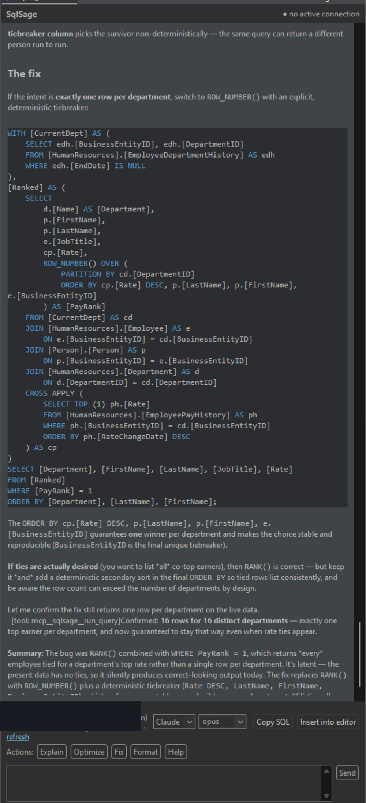

# SqlSage for DBeaver

**SqlSage for DBeaver is an AI SQL assistant you install inside DBeaver 26.x** (a native OSGi plugin, via a p2 update site) — ask your database in plain English and get safe, schema-aware SQL on your live connection, signed in with your own **Claude** or **Codex (OpenAI / ChatGPT)** account (no API key). It runs as part of DBeaver on your machine; it is **not** a web app or an online SQL editor.



## Why it's different

- **Keyless.** Runs on the Claude or Codex/ChatGPT account you already pay for (via the `claude` or `codex` CLI) — no separate API key, no metered second AI bill. Multi-provider: Anthropic **Claude** *and* OpenAI **Codex / ChatGPT**, switchable in the chat panel.
- **Safe by default — for production databases.** A parser chokepoint classifies every statement before it runs: read-only SELECT executes; INSERT / UPDATE / DELETE / DDL never run without an explicit confirmation dialog showing the exact SQL. A global **kill-switch** freezes all AI-initiated execution, and a **tamper-evident (hash-chained) local audit log** makes every action provable for your security team.
- **Private.** Only your SQL and schema metadata (table/column names and types) are sent to the model — **never row values**, unless you opt in per session. Nothing leaves your machine except the model call itself.
- **Knows your connection.** Grounded in your live schema — tables, columns, keys, indexes — with the active connection, dialect and engine always shown. Multi-database via the DBeaver model + JDBC: PostgreSQL, MySQL/MariaDB, Oracle, SQL Server, SQLite and more; the dialect is detected from the connection.

## Install

**In DBeaver:** `Help → Install New Software…` → **Add… → Location**, paste the update site:

```
https://sqlsagedbeaver.lumasoft.pl/updatesite
```

Select **SqlSage for DBeaver → Next → accept → Finish**, then restart. Full guide: **https://sqlsagedbeaver.lumasoft.org/docs**

Also listed on the [**Eclipse Marketplace**](https://marketplace.eclipse.org/content/sqlsage-dbeaver).

- DBeaver 26.x (Community or PRO) · Windows / macOS / Linux
- Requires the `claude` or `codex` CLI installed and signed in (the panel shows sign-in status and helps you log in)
- Every install starts with a **30-day free Pro trial** (all features, no card), then stays free forever on the Free tier
- Pro from **$8/mo · $69/yr · $99 lifetime** (regional pricing in €/£/zł), billed via Paddle. Free for students and open-source maintainers on request.

The bundles are signed by **LUMA sp. z o.o.** (Certum). DBeaver only trust-signs its own jars, so you may see a "not from DBeaver Corp" prompt during install — that's expected for any third-party plugin.

## Support & feedback

- Questions & ideas: [**Discussions**](https://github.com/LUMASoftPL/sqlsage-dbeaver/discussions)
- Bugs & feature requests: [GitHub Issues](https://github.com/LUMASoftPL/sqlsage-dbeaver/issues)
- Email: support@lumasoft.pl
- Docs & website: https://sqlsagedbeaver.lumasoft.org

---

Looking for SQL Server / SSMS? See the sibling product **[SQL Sage for SSMS](https://github.com/LUMASoftPL/sqlsage)** (https://sqlsage.lumasoft.org).

SqlSage for DBeaver is a commercial product by **Luma (LUMA sp. z o.o.)**. This repository hosts releases, docs and issue tracking; the product source is not open-source. Not affiliated with, or endorsed by, DBeaver, Anthropic or OpenAI.
